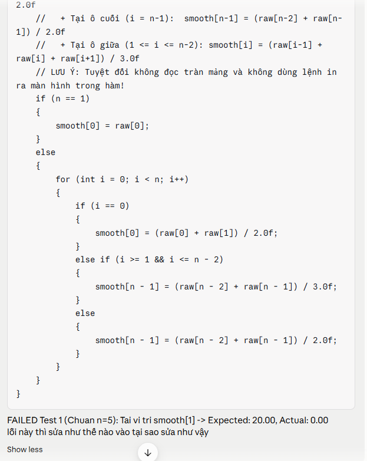
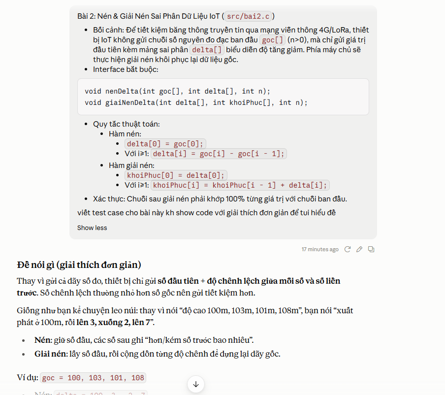

# NHẬT KÝ THỰC HIỆN LAB 6 (LOGBOOK)

- **Họ và tên:Trần Quốc Toản**
- **Mã sinh viên: PS51869**
- **Link Repository cá nhân:**

> [!NOTE]
> **HƯỚNG DẪN DÀNH CHO KỶ NGUYÊN AI:**  
> Bạn được khuyến khích sử dụng AI (Cursor, Copilot, ChatGPT, Claude) như một trợ lý lập trình. Tuy nhiên, AI thường xuyên sinh mã lỗi đối với các trường hợp biên (biên mảng, số âm, tràn chỉ số). Hãy ghi lại trung thực quá trình bạn phát hiện và khắc phục lỗi của AI.

---

### Lần 1: Bài 1 - Bộ Lọc Làm Mịn Tín Hiệu (Moving Average)

- Trạng thái: Chờ chấm
- Prompt hỏi AI (nếu có): Tự làm không dùng AI
- Lỗi phát hiện qua Test (nếu có): Chưa có
- Cách sửa / Bài học: Chờ kết quả phản hồi từ GitHub Actions

### Lần 2: Bài 1

- Trạng thái: Sửa lỗi lần 2
- Lỗi: FAILED Test 1 (Chuan n=5): Tai vi tri smooth[1] -> Expected: 20.00, Actual: 0.00
- Nguyên nhân: smooth[n - 1] = (raw[n - 2] + raw[n - 1]) / 3.0f;
- Cách sửa: smooth[i] = (raw[i-1] + raw[i] + raw[i+1]) /3.0f;
- Dùng AI fix bug
  

### Lần 3: Bài 1 (Dự phòng)

- Trạng thái: Pass 100%
- Lỗi / Cách sửa:

---

### Lần 4: Bài 2 - Nén Sai Phân Dữ Liệu IoT (Delta Encoding)

- Trạng thái: Chờ chấm
- Prompt hỏi AI (nếu có): Dùng AI giải thích đề & viết test case
  
- Lỗi phát hiện qua Test (nếu có): Chưa có
- Cách sửa / Bài học: Chờ kết quả phản hồi từ GitHub Actions

### Lần 5: Bài 2

- Trạng thái:
- Lỗi / Cách sửa:

### Lần 6: Bài 2 (Dự phòng)

- Trạng thái:
- Lỗi / Cách sửa:

---

### Lần 7: Bài 3 - Bộ Lọc Làm Mờ Điểm Ảnh (Box Blur Filter 3x3)

- Trạng thái:
- Prompt hỏi AI (nếu có):
- Lỗi phát hiện qua Test (nếu có):
- Cách sửa / Bài học:

### Lần 8: Bài 3

- Trạng thái:
- Lỗi / Cách sửa:

### Lần 9: Bài 3 (Dự phòng)

- Trạng thái:
- Lỗi / Cách sửa:

---

### Lần 10: Bài 4 - Radar Dò Điểm Nóng (Thermal Peak Detection)

- Trạng thái:
- Prompt hỏi AI (nếu có):
- Lỗi phát hiện qua Test (nếu có):
- Cách sửa / Bài học:

### Lần 11: Bài 4

- Trạng thái:
- Lỗi / Cách sửa:

### Lần 12: Bài 4

- Trạng thái:
- Lỗi / Cách sửa:

### Lần 13: Bài 4 (Dự phòng)

- Trạng thái:
- Lỗi / Cách sửa:
